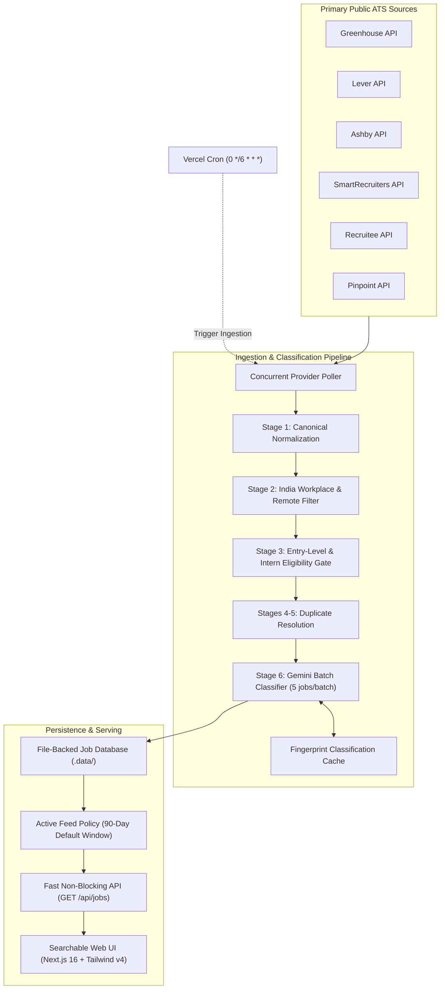

# GradHunt

An autonomous fresher and internship intelligence platform for India that aggregates, normalizes, and semantically classifies entry-level tech roles directly from primary public ATS boards.

---

## Architecture Diagram



---

## Sequential Execution Flow (Start to Finish)

When a refresh occurs (triggered on a 6-hour Vercel cron, on manual request, or in the background when the store is empty), the pipeline executes the following stages sequentially:

1. **Multi-Source Ingestion**: The system queries public, unauthenticated job feeds across Greenhouse, Lever, Ashby, SmartRecruiters, Recruitee, and Pinpoint for configured tech employers, fetching over 13,000 raw listings in parallel with per-provider failure isolation and timeouts.
2. **Canonical Normalization**: Raw API payloads are converted into a uniform `Job` data model, preserving original source identifiers, company names, direct ATS application URLs, and timestamps.
3. **Strict India Geocoding**: Each job is evaluated against Indian cities, states, and India-specific remote indicators. Roles located outside India are rejected (~12,500 non-India listings excluded).
4. **Candidate Eligibility Gate**: Fast deterministic rules evaluate titles and descriptions to exclude senior, staff, lead, and manager positions. Verified student internships and 0-2 year experience fresher roles are passed forward (~250 viable candidate jobs).
5. **Deduplication**: Multi-department and cross-source duplicates are identified and merged using company, title, and location fingerprinting.
6. **Gemini Semantic Classification**: Viable candidates are grouped into compact batches of 5 jobs per prompt. Google Gemini (`gemini-3.5-flash-lite`) validates fresher suitability, assigns standardized role taxonomy clusters, and extracts verified workplace models. Results are cached by SHA-256 fingerprint.
7. **Database Persistence**: Verified jobs are committed to memory and serialized atomically to disk (`.data/jobs-store.json`). Active listings retain their original source timestamps while updating availability metadata.
8. **Decoupled Client Retrieval**: The client endpoint (`GET /api/jobs`) reads immediately from the stored database in under 5 milliseconds, enabling responsive sorting, search, and dynamic filtering.

---

## Architectural Rationale: Why This Approach?

### 1. Direct Public ATS Endpoints vs. Scraping or Aggregators
- Web scraping job boards frequently breaks due to DOM alterations, Cloudflare challenges, and IP rate limits. 
- Third-party aggregators introduce data delays, stale links, and referral intermediaries.
- Directly querying the public JSON feeds of Greenhouse, Lever, Ashby, SmartRecruiters, Recruitee, and Pinpoint ensures 100% genuine postings with direct links to the employer's official application form.

### 2. Pre-LLM Deterministic Candidate Gating
- Sweeping 115+ company boards yields over 13,000 raw postings. Passing all 13,000 to an LLM would incur substantial API cost and exhaust quota limits.
- The pipeline applies strict microsecond regex and geocoding to eliminate non-India and senior requisitions first.
- Only ~250 viable candidate opportunities reach Gemini, completing in roughly 3 minutes for approximately $0.02 USD per run.

### 3. Batched LLM Classification with Payload Fingerprints
- Individual per-job LLM calls require hundreds of round trips and trigger per-minute request limits.
- Grouping 5 postings per prompt with compact excerpts (up to 650 characters) reduces prompt overhead by over 60%.
- A SHA-256 cache avoids re-evaluating unchanged job descriptions across subsequent syncs.

### 4. Decoupling Retrieval from Ingestion
- Users must never experience a 3-minute load spinner while external APIs are polled.
- `GET /api/jobs` answers strictly from the in-memory/disk store in sub-5ms time. Ingestion runs asynchronously in the background.

### 5. Active Feed Freshness Policy vs. Hard Deletions
- Employers routinely keep legitimate entry-level and internship requisitions open for 60 to 120 days.
- Hard cutoffs at 7 or 30 days eliminate genuine active roles.
- GradHunt retains all verified active jobs, sorts newest-first, and applies a default 90-day active window that users can adjust (7d, 30d, 60d, 90d, 365d, or all).

### 6. Purging the NCS Feed
- The legacy National Career Service (NCS) RSS endpoint was serving an Angular single-page application HTML page rather than structured feed data.
- To uphold the rule of zero fabricated or scraped data, NCS was completely removed from the provider registry.

---

## Technical Specifications

- **Frontend & Fullstack Framework**: Next.js 16 (App Router, Webpack), React 19, TypeScript
- **Styling**: Tailwind CSS v4, Lucide React, Base UI
- **LLM Engine**: Google Gemini API (`gemini-3.5-flash-lite`) via Google AI Studio
- **Data Validation**: Zod runtime schema validation
- **Scheduling**: Vercel Cron (`0 */6 * * *`)

---

## Environment Setup

Create `.env.local` containing your Google Gemini API key:

```bash
cp .env.example .env.local
```

Populate the key in `.env.local`:

```env
GEMINI_API_KEY=your_gemini_api_key_here
```

---

## Local Development

```bash
# Install dependencies
npm install

# Run the development server
npm run dev
```

Visit `http://localhost:3000`. The application will initialize and perform background synchronization if the local store is empty.

To run a production build:

```bash
npm run build
npm start
```

---

## Deploying to Vercel

1. Commit and push the repository to GitHub:
   ```bash
   git add .
   git commit -m "feat: complete production ready GradHunt"
   git branch -M main
   git remote add origin https://github.com/<your-username>/<your-repo-name>.git
   git push -u origin main
   ```
2. Import the repository in [Vercel](https://vercel.com).
3. Set the `GEMINI_API_KEY` environment variable in the Vercel dashboard.
4. Deploy. The schedule in `vercel.json` (`0 */6 * * *`) automatically triggers periodic data refreshes every 6 hours.
